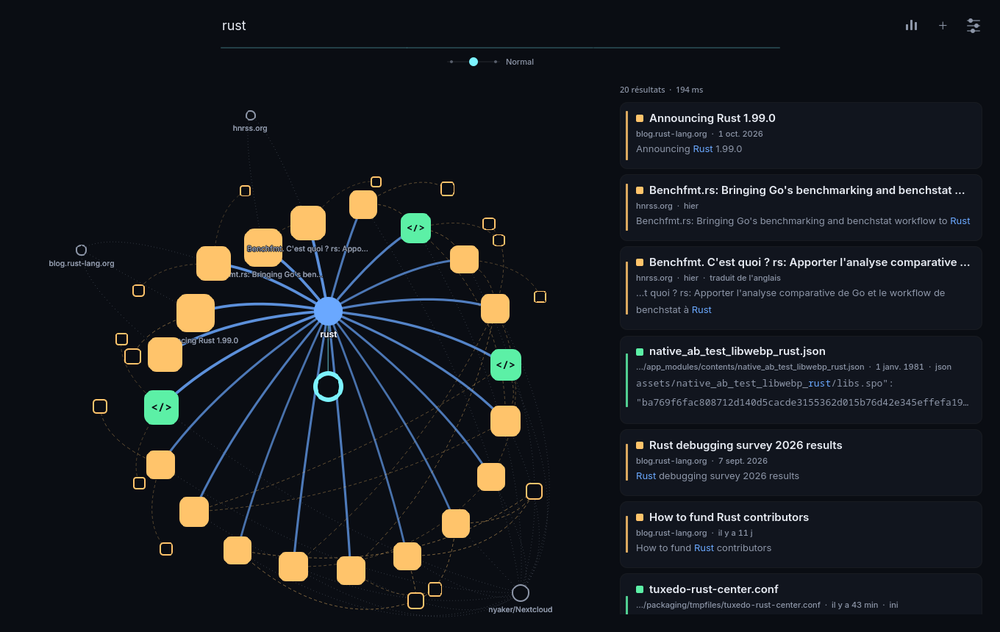
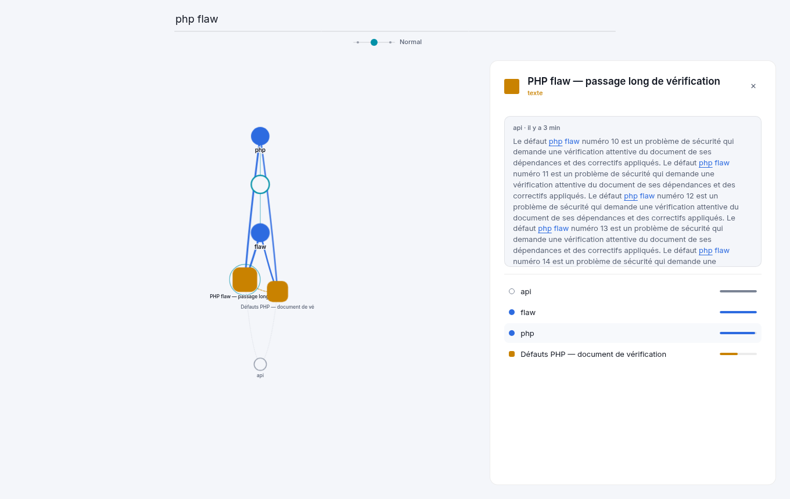

# NKnown

Base de connaissances en Rust. Elle collecte des sources (RSS, fichiers, sites, Wikipedia),
analyse les textes dans toutes les langues et relie mots, sens, passages et documents
dans un graphe pondéré interrogeable (`@actu paris`, `@code @new tokenizer`…).

## Installation

En une ligne (toute distribution Linux x86_64) :

```sh
curl -fsSL https://raw.githubusercontent.com/fnyaker/nknown/main/packaging/install.sh | bash
```

Installe `nknown` dans `~/.local/bin` (`--system` : `/usr/local`), active le démon `nknownd`
(service systemd utilisateur, `--no-service` pour s'en passer) ; `--uninstall` désinstalle. Rien
n'est écrit dans `/etc`. Les modèles (291 Mo) sont téléchargés au premier lancement du démon.

L'app graphique sur toute distribution, en Flatpak (runtime KDE, installé au besoin depuis Flathub) :

```sh
curl -fLO https://github.com/fnyaker/nknown/releases/latest/download/NKnown-x86_64.flatpak
flatpak install --user NKnown-x86_64.flatpak
flatpak run io.github.fnyaker.NKnown
```

Sur Arch, le paquet de la release (`pacman -U nknown-bin-*.pkg.tar.zst`) contient l'app, le
démon et l'intégration Plasma (KRunner, zone de notification).

Chaque [release](https://github.com/fnyaker/nknown/releases) fournit aussi : AppImage, Flatpak,
`.deb`, `.rpm`, paquet Arch (`pacman -U`), archive portable (`tar.gz` ou `zip`, avec `install.sh`),
et `SHA256SUMS`. Un seul binaire : `nknown` (ligne de commande), `nknownd` ou `nknown daemon`
(démon). Paquets construits par `packaging/build.sh`, publiés par la CI à chaque tag `v*`.

## App



`nknown-app` (Qt6/QML via cxx-qt) : un champ de recherche, puis la carte des chemins qui mènent
aux résultats, construite en direct, et la liste. Cliquer un nœud ouvre l'inspecteur (ses liens
par poids) ; cliquer un résultat le met en valeur dans la carte ; Échap revient en arrière.
Le moteur est le démon local, ou le cœur embarqué si le démon est arrêté. Règles visuelles :
[`docs/ui-guidelines.md`](docs/ui-guidelines.md).

```sh
cargo run --release -p nknown-desktop
# captures hors écran (essais visuels) :
QT_QPA_PLATFORM=offscreen NKNOWN_APP_SNAPSHOT=/tmp/nk NKNOWN_APP_QUERY="ma requête" nknown-app
```

## Crates

| Crate | Rôle |
|---|---|
| `nknown-core` | Types et traits partagés : `Source`, `RawItem`, `Analyzer`, `Lang`, `NatureProfile`, dates |
| `nknown-sources` | Sources : fichiers locaux, flux RSS/Atom/JSON Feed, Wikipédia (titres, recherche, catégorie) |
| `nknown-nlp` | Segmentation prose / code (blocs imbriqués), analyse du code, pipeline linguistique : lexique (`fst`), tagueur, rattachement des adjectifs |
| `nknown-engine` | Moteur : graphe (lemmes, passages, documents, qualifications), index BM25, modificateurs de requête (`@actu`, `@code`, `@new`…), stockage redb |
| `nknown-cli` | Binaire `nknown` |
| `nknown-api` | Types de l'API REST (requêtes, résultats, graphe, évènements de progression), compatibles WASM |
| `nknown-service` | Façade du cœur : modèles, recherche avec progression, graphe de résultats, collecte, surveillance des dossiers, config XDG |
| `nknown-server` | Serveur HTTP (axum) : `nknown-server` (distant, jeton, interface web) et `nknownd` (démon local, socket Unix) |
| `nknown-graph` | Disposition de la carte des résultats (radiale, déterministe), partagée app / web |
| `nknown-desktop` | App native Qt6/QML (`nknown-app`) |

Architecture de distribution (app Qt6, démon, serveur Docker, interface web) :
[`docs/architecture.md`](docs/architecture.md). Charte d'interface :
[`docs/ui-guidelines.md`](docs/ui-guidelines.md), jetons dans [`design/tokens.toml`](design/tokens.toml).

## Utilisation

```sh
# Lexique français : Wiktextract (couverture) + Lexique 3.83 (fréquences)
#   https://kaikki.org/dictionary/French/kaikki.org-dictionary-French.jsonl
#   http://www.lexique.org/databases/Lexique383/Lexique383.tsv
nknown lexicon build fr.lex \
    wiktextract kaikki.org-dictionary-French.jsonl fr \
    lexique Lexique383.tsv
nknown lexicon lookup fr.lex été "l'" aujourd'hui

# Liens de sens (« élection » → scrutin, suffrage…) : synonymes, mots apparentés, mots des
# définitions et voisins communs, pondérés ; la recherche s'en sert pour élargir les requêtes.
#   https://kaikki.org/frwiktionary/Français/kaikki.org-dictionary-Français.jsonl.gz
zcat kaikki.org-dictionary-Français.jsonl.gz | nknown relations build fr.rel fr.lex - fr
nknown relations lookup fr.rel élection voiture

# Tagueur (couche 2) entraîné sur UD French-GSD (CC BY-SA 4.0)
#   https://github.com/UniversalDependencies/UD_French-GSD
nknown tagger train fr.lex fr_gsd-ud-train.conllu fr.tag
nknown tagger eval fr.lex fr_gsd-ud-test.conllu fr.tag
nknown analyze fr.lex "Les rues calmes de Paris." fr.tag

nknown ingest <dossier> [fr.lex]
```

Le Wiktionary (CC BY-SA 3.0/4.0) et Lexique 3.83 (CC BY-SA 4.0) sont sous licence à partage
à l'identique : un lexique compilé en hérite.

## Base de connaissances

```sh
nknown index base.redb data/fr.lex @examples/sources.txt data/fr.tag   # ou data/parser-fr (couche 3)
nknown index base.redb data/fr.lex rss:https://www.lemonde.fr/rss/une.xml data/fr.tag
nknown index base.redb data/fr.lex "wiki:fr:Paris|Lyon" data/fr.tag
nknown index base.redb data/fr.lex <dossier> data/fr.tag
nknown search base.redb data/fr.lex "@actu paris"
nknown search base.redb data/fr.lex "paris sportifs"         # bonus si « sportifs » qualifie « paris »
```

Variantes d'un mot : chaque lemme indexé est rangé sous sa racine (Snowball pour les langues qui en
ont une) ; une requête cherche aussi les lemmes de même racine (« midterm » trouve « Midterms »
indexé comme nom propre), avec un poids un peu moindre que les lectures directes.

Taille de la base : redb ne rend jamais la place libérée, et les insertions dans le désordre
laissent des pages à moitié vides. Au démarrage, une base dont plus d'un tiers est perdu est
réécrite dans l'ordre des clés (÷2 mesuré), et mise au format courant (migration automatique).
`nknown stats <base.redb>` montre l'occupation par type de donnée ; `nknown compact <base.redb>`
force la réécriture (démon arrêté).

Modificateurs de requête, combinables, n'importe où dans la requête :

| Modificateur | Effet |
|---|---|
| `@code` / `@doc` | passages de code / prose technique d'abord |
| `@actu`, `@info`, `@avis`, `@tuto`, `@perso` | type de contenu (l'actualité privilégie le récent) |
| `@new` (`@récent`) | un peu de priorité aux contenus récents |
| `@wiki`, `@rss`, `@web`, `@fichiers` | seulement cette famille de sources |

Sources : `<dossier>`, `rss:<url>`, `wiki:<édition>:<Titre>|<Titre>`, `wiki-search:<édition>:<requête>`,
`wiki-cat:<édition>:<Catégorie>`, `wiki-top:<édition>:<N>` (les N articles les plus lus),
`wiki-dump:<édition>[:<N>]` (l'édition entière, ou ses N premiers articles, lue dans le dump),
`web:<url> [pages=<n>] [depth=<n>]` (exploration d'un site, voir plus bas), `@<fichier>` (une par
ligne). Les requêtes HTTP sont espacées
(1/s pour Wikipédia) et reprises sur 429/503 ; `NKNOWN_USER_AGENT` permet d'y ajouter un contact.
La collecte est incrémentale : un contenu inchangé n'est ni retéléchargé (Wikipédia : dates de
révision par lots de 50) ni réanalysé ; une version modifiée remplace l'ancienne.
`nknown watch base.redb data/fr.lex @examples/sources.txt 30m data/fr.tag` relance la collecte
toutes les 30 minutes.

Paliers de Wikipédia : `wiki-top` cumule les listes mensuelles des articles les plus consultés
(API Wikimedia) puis télécharge les articles, cinq par seconde au plus, et se remet à jour chaque
semaine. `wiki-dump` lit le dump « multistream » bloc par bloc (requêtes `Range`, bzip2 en Rust pur) :
rien n'est stocké hors de la base, l'avancement l'est (`<données>/wikipedia/`), une collecte
interrompue ou mise en pause reprend au bloc suivant, et un dump terminé n'est relu qu'à la
publication du suivant. Ces gros volumes sont indexés sans l'analyseur neuronal. Une source se met
en pause (`POST /sources/{id}/pause`) ; `POST /wikipedia/estimate` donne l'ordre de grandeur
(articles, téléchargement, place, durée) avant de lancer.

Exploration de site (`web:`) : même hôte, sous le dossier de l'adresse de départ, 200 pages et
3 niveaux de liens par défaut, HTML seulement. `robots.txt` est respecté (`Crawl-delay` compris),
une page par seconde au plus. Devant une protection anti-robot (captcha, défi Cloudflare,
DDoS-Guard, 429…), l'exploration s'arrête et la source passe en échec : rien n'est contourné.

Tout type de contenu : une même page peut mêler prose, blocs de code (Markdown, `<pre>`, ou code
collé sans balisage, reconnu ligne par ligne), code en ligne (`` `HashMap` ``, `read_to_string()`),
et dans le code, des commentaires et docstrings traités comme de la prose. Les termes de code
(identifiants, chemins `std::fs::read`, morceaux `hash`/`map` de `HashMap`) ont leur propre espace :
« map » dans un texte anglais n'est pas `map` dans du code. Les fichiers locaux couvrent code,
configuration et documentation (`target/`, `node_modules/`, `.git/`… ignorés).

Intentions reconnues dans la requête : `actu` (événements récents), `info` (référence),
`avis`, `tuto`, `perso`, `code` (passages de code), `doc` (prose technique).
Un identifiant tapé tel quel (`read_to_string`, `HashMap::new`) est cherché exactement.
Les mots présents dans le titre d'un document pèsent plus, et un titre qui correspond suffit à
rendre le document candidat (fichier `mst.rs` pour « mst »). Les passages proches sont reliés
entre documents : une même information reprise par plusieurs sources est regroupée (« aussi »),
et pour `actu`, un sujet repris par plusieurs sources récentes remonte.

Le score d'un résultat est le produit de facteurs nommés (texte, couverture, qualification,
titre, nature, fraîcheur, emballement, soutien des voisins dans le graphe, autorité PageRank du
document) ; `nknown search … --explain` les affiche avec les seuils appliqués. Plusieurs seuils
sont dynamiques : exigence de couverture selon le nombre de passages complets, demi-vie de
`actu` allongée si le corpus est ancien, coupure relative au meilleur score selon le nombre de
candidats, fusion des doublons selon la redondance des résultats, liens d'un passage relatifs à
son meilleur voisin. `nknown rank base.redb` calcule l'autorité (aussi après chaque `watch`). Un mot ambigu (« paris ») est cherché sous toutes ses lectures,
pondérées par leur usage dans la base.

## Mesures (UD French-GSD, test)

| | Couche 1 seule | + tagueur (couche 2) | + analyseur neuronal (couche 3) |
|---|---|---|---|
| Catégories (UPOS) | 81,0 % (dev) | 97,6 % | **98,3 %** |
| Adjectifs `amod` : rappel / précision | 67,4 % / 86,8 % (dev) | 83,7 % / 87,3 % | **94,6 % / 94,4 %** |
| Dépendances UAS / LAS | — | — | **95,1 % / 92,4 %** |

Couche 3 : XLM-RoBERTa base affiné 3 passes sur French-GSD, ~35 min sur Radeon 780M (Vulkan).
Résultats identiques avec le moteur CPU (candle) et le moteur GPU (burn/Vulkan).

```sh
# entraînement sur GPU (ou sans « vulkan » : sur CPU, ~2× plus lent)
nknown parser train vulkan xlm-roberta-base/ fr_gsd-ud-train.conllu fr_gsd-ud-dev.conllu parser-fr/ 3
nknown eval fr.lex fr_gsd-ud-test.conllu vulkan:parser-fr/
nknown analyze fr.lex "Les rues calmes de Paris." parser-fr/
```

## Mesures multilingues (UD, test)

Un seul analyseur neuronal pour français, anglais, russe et chinois (`parser-multi`, 3 passes sur
48 838 phrases mêlant les quatre langues, ~1 h 45 sur Radeon 780M). Il fait aussi bien que le
modèle français seul sur le français : partager le modèle ne coûte rien.

| Corpus | Tagueur (couche 2) | UPOS (couche 3) | `amod` rappel / précision | UAS / LAS |
|---|---|---|---|---|
| French-GSD | 97,6 % | 98,3 % | 94,8 % / 95,4 % | 95,1 % / 92,4 % |
| English-EWT | 95,3 % | 97,6 % | 92,9 % / 92,9 % | 94,9 % / 93,0 % |
| Russian-GSD | 96,3 % | 97,8 % | 95,2 % / 98,0 % | 93,6 % / 90,2 % |
| Russian-Taiga | 96,8 % | 96,5 % | 94,0 % / 96,6 % | 89,2 % / 85,1 % |
| Chinese-GSDSimp | 92,6 % | 96,4 % | 65,8 % / 70,2 % | 87,9 % / 84,7 % |

Le chinois a peu d'adjectifs `amod` (190 dans le test) : beaucoup de qualifiants y sont des noms
ou des relatives en 的, annotés autrement.

```sh
nknown parser train vulkan xlm-roberta-base/ multi-ud-train.conllu multi-ud-dev.conllu parser-multi/ 3 --langs=fra,eng,rus,zho
nknown eval data/ en_ewt-ud-test.conllu vulkan:data/parser-multi   # langue tirée du nom du corpus
```

### Analyseur quantifié sur CPU

Sur GPU (Vulkan), tout le calcul y reste : table des plongements en entiers 8 bits (une échelle
par ligne, ~192 Mo), couches et têtes en f16 si le GPU le permet (sinon f32 ;
`NKNOWN_VULKAN_F32=1` l'impose), un seul retour par lot (arcs, catégories, traits, étiquettes de
tous les couples ; l'arbre est choisi sur le CPU). Mesuré sur Radeon 780M : French-GSD test en
6,9 s au lieu de 11,8 s (f32) et 11,9 s sur 8 cœurs CPU, LAS identique (92,38) ; 5 articles de
Wikipédia (620 Ko) indexés en 39 s au lieu de 80 s. Des couches en 8 bits n'apportent rien de
plus : le GPU est limité par le calcul, pas par la mémoire.

Sur CPU, l'encodeur est quantifié au chargement, en deux options (`parser_precision` dans la
configuration) :

- **`standard`** (défaut) : la table des plongements (70 % des poids, lue ligne à ligne puis
  normalisée) en 4 bits (Q4_K), les matrices des couches en 8 bits (Q8_0) ;
- **`light`** : tout l'encodeur en 4 bits.

Les têtes restent en f32. Le modèle converti est enregistré à côté du modèle f32
(`model.q4k-q8.gguf`, `model.q4k.gguf`) ; ensuite seul ce fichier est lu. En ligne de commande :
`light:<dossier>`, et `f32:<dossier>` pour la pleine précision. Mesures de toutes les variantes
essayées :

| | f32 | 8 bits | 6 bits | **4 + 8 bits (`standard`)** | 4 bits (`light`) |
|---|---|---|---|---|---|
| Poids sur disque | 1 120 Mo | 307 Mo | 240 Mo | **211 Mo** | 169 Mo |
| Démon avec l'analyseur (tokeniseur `tokenizers`) | 1 548 Mo | 763 Mo | 688 Mo | 668 Mo | 618 Mo |
| Démon avec l'analyseur (tokeniseur NKnown) | | | | **371 Mo** | **328 Mo** |
| French-GSD, test complet (CPU, 6 fils) | 16,8 s | 12,3 s | 12,7 s | **11,8 s** | 11,6 s |

| LAS | f32 | 8 bits | 6 bits | **4 + 8 bits** | 4 bits |
|---|---|---|---|---|---|
| French-GSD | 92,40 % | 92,41 % | 92,27 % | **92,37 %** | 91,66 % |
| English-EWT | 93,0 % | 92,85 % | 92,87 % | **92,94 %** | 92,10 % |
| Russian-GSD | 90,2 % | 90,20 % | 90,23 % | **90,13 %** | 89,79 % |
| Russian-Taiga | 85,1 % | 85,01 % | 85,12 % | **84,98 %** | 84,11 % |
| Chinese-GSDSimp | 84,7 % | 84,61 % | 84,40 % | **84,59 %** | 83,16 % |

Toute la perte du 4 bits vient des couches : la table, elle, s'en accommode sans rien perdre. Le
8 et le 6 bits uniformes, moins bons que `standard` en mémoire à précision égale, ne sont pas
gardés.

Le tokeniseur XLM-R est réimplémenté (`nknown_neural::tokenizer`) : chargé par `tokenizers`, il
occupait ~295 Mo (un trie de tables de hachage pour 250 002 sous-mots) ; ici les sous-mots tiennent
dans un automate `fst`, et `tokenizer.json` est converti une fois en `tokenizer.nkt` (4,9 Mo).
Découpage identique à `tokenizers` sur les 164 958 phrases des corpus UD (4 616 034 sous-mots) et
sur des cas limites (`cargo test --release -p nknown-neural same_as_huggingface -- --ignored`).

## Démon local

```sh
cargo build --release -p nknown-server --bin nknownd            # sans analyseur neuronal
cargo build --release -p nknown-server --bin nknownd --features neural
nknownd                     # socket : $XDG_RUNTIME_DIR/nknown/nknownd.sock (0600)
curl --unix-socket "$(nknownd --socket)" http://x/api/v1/status
```

Au premier lancement, le démon télécharge les modèles (lexiques et tagueurs des 4 langues,
analyseur quantifié : 291 Mo) depuis la release `models-v1` du dépôt, vérifie leur SHA-256 et les
charge sans redémarrer ; `/status` montre la progression, et rien n'est indexé avant qu'ils soient
là. À la main : `nknown models status`, `nknown models fetch`. Nouvelle release de modèles :
`packaging/models/stage.sh`.

Configuration `$XDG_CONFIG_HOME/nknown/config.toml` (créée au premier ajout de source) :

```toml
sources = ["/home/moi/Documents", "rss:https://exemple.org/flux.xml"]
collect_every = "30m"     # collecte périodique (minimum 1 min)
watch_files = true        # réindexe les dossiers à chaque modification
# models = "/chemin/des/modèles"   # défaut : $XDG_DATA_HOME/nknown/models
# parser = "parser-multi"          # analyseur XLM-R quantifié (défaut) ; "" pour s'en passer
#                                  # (~215 Mo de mémoire en moins, adjectifs moins bien reliés)
# parser_precision = "standard"    # ou "light" : ~50 Mo de moins, ~1 point de LAS en moins
# parser_device = "auto"           # "gpu" (Vulkan), "cpu" ; auto : GPU s'il répond, sinon CPU
# compute_threads = 0              # fils de calcul sur CPU, en priorité basse (0 : ¼ des cœurs)
```


Service utilisateur systemd (priorité basse, E/S en tâche de fond) :
[`packaging/systemd/nknownd.service`](packaging/systemd/nknownd.service).

## Serveur (Docker)

```sh
docker compose up -d                       # écoute sur 127.0.0.1:8080, données dans le volume
docker compose exec nknown cat /data/token # jeton généré au premier démarrage
curl -H "Authorization: Bearer $JETON" http://127.0.0.1:8080/api/v1/status
```

Modèles dans `/data/models` ; l'analyseur neuronal s'ajoute avec
`docker build --build-arg FEATURES=neural`. L'interface web utilise un cookie `Secure` :
exposez-la derrière un proxy HTTPS.

L'interface web (Leptos, WebAssembly) reprend la charte de l'app : champ seul, carte en direct,
liste, inspecteur, thèmes clair et sombre. Le jeton s'échange contre un cookie de session
`HttpOnly` ; aucun script en ligne (CSP stricte). Construction : `crates/nknown-web/build.sh`
(cible `wasm32-unknown-unknown`, `wasm-bindgen` 0.2.128, `wasm-opt`), servie via `NKNOWN_WEB`.



